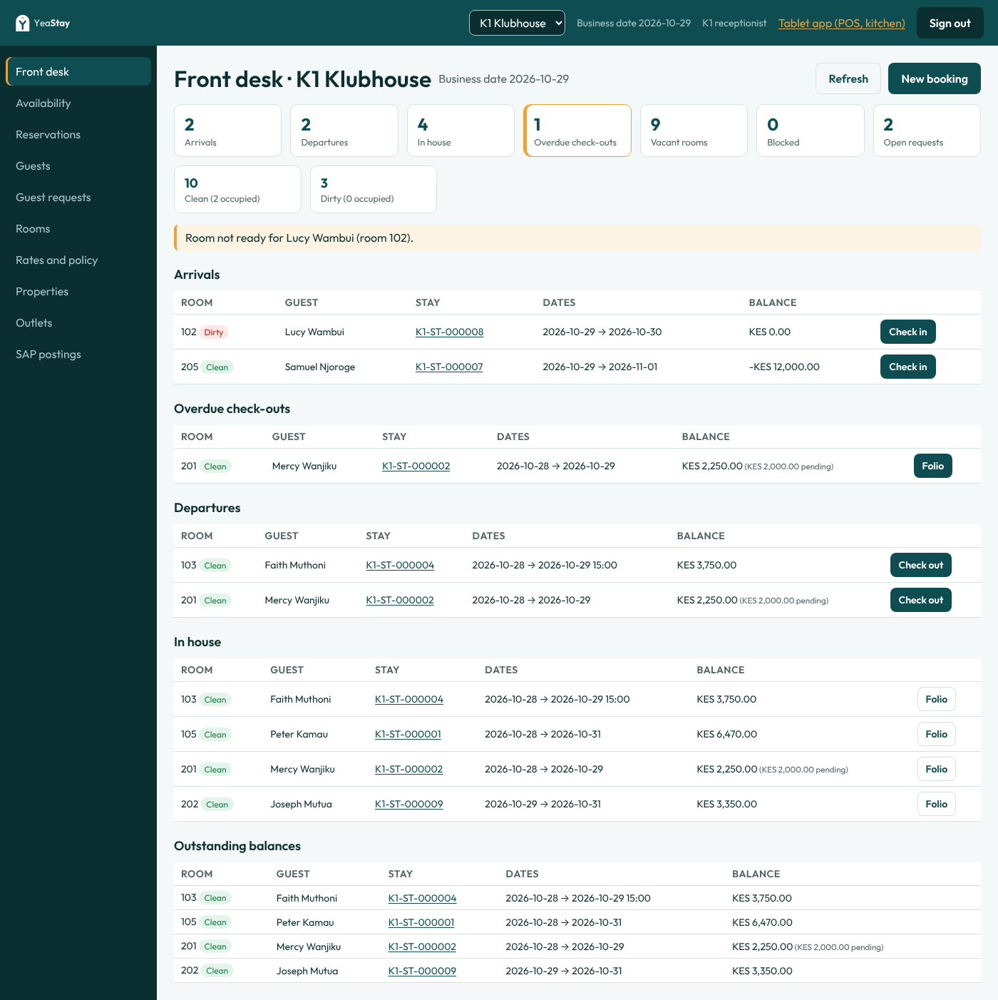

# Demo data: what it creates and where to see it

The demo seed fills a stack with realistic activity at all three properties, dated around today, so every scenario in [how-to-test-reservations.md](how-to-test-reservations.md) and [how-to-test-pos.md](how-to-test-pos.md) can be shown without setting it up by hand.

Everything is created through the app's own API, signed in as the seeded users, exactly as staff would do it at the desk or on a tablet. Numbers, prices, taxes, deposits, approvals and idempotency keys all follow the normal rules (brief §9). Nothing is written to the database directly and nothing that is finalised is edited afterwards.

All guests, phone numbers and ID numbers are invented. Demo guests have the note **"Demo data"** on their profile and phone numbers starting `+254 700 55`. Demo bookings carry the reference **`DEMO-<date>`** (search for it on **Reservations**) and the note "Demo data: …". POS checks carry the note "Demo data".

## Running it

Run it after the normal seed, against a running API, with the same `SEED_PASSWORD`.

```bash
# locally
API_URL=http://localhost:3000/api SEED_PASSWORD=dev-password-123 npm run db:demo

# on a stack (back up the database first; see deploy-ec2.md)
docker compose -p hotel-test --env-file deploy/env/test.env -f deploy/compose.stack.yaml --profile demo run --rm demo
```

It prints one line per scenario (✓ or ✗ with the reason) and a summary. A scenario that cannot be created, for example because a tester has taken every Standard room at K1, is reported and the rest carry on.

| Setting | Default | Meaning |
|---|---|---|
| `DEMO_PROPERTIES` | `K1,SW,KM` | Which properties to fill |
| `DEMO_HISTORY` | `auto` | `auto`: if a property's business date is behind today, guests "arrive yesterday" and the demo closes the day up to today. `off`: everyone arrives today. `on`: close one day even if the date is already today (moves the business date forward) |
| `DEMO_FORCE` | off | Add another set even if one exists for this date |

**Dates.** Guests who should look as if they arrived yesterday are booked and checked in on the property's current business date, and then the manager closes that day, which posts their room night as the night audit does. This only happens when the business date is behind today's date in Nairobi. If it is already today, those guests arrive today instead: they show as in-house but nobody is "due out today", and the summary says so.

**Running it again** on the same business date does nothing for a property that already has its demo. On a later date it adds a new set dated around that day; earlier demo records stay, because finalised records are never deleted.



## After loading: things to know

- **K1 Reception Shop, Small World Swimming and Kahama Swimming Pool are closed for today** (they show the Z report). They can trade again once the property's business day is closed.
- **Open cash shifts:** `k1.waiter` at Cowgirl Bar, `sw.waiter` at Small World Main Bar, `km.waiter` at Kahama Cocktail Bar. Close them (Cash shift → Close) before closing those outlets' POS day.
- **Closing a property's business day** needs every outlet with sales closed first (POS day close), which means settling or voiding the open tables. That is how the day close is meant to work, so it is a good thing to demonstrate last.
- K1 has only 13 rooms. The demo uses about eight of them for today, so leave K1 for walkthroughs and use Small World for free-form testing.

## Users

Every user's password is the stack's `SEED_PASSWORD`. Back office is the site root `/`; the tablet app is `/pwa/`.

## Front desk (back office)

| Scenario | Property and guest | Sign in as | Where to look |
|---|---|---|---|
| Arrivals today | K1 Samuel Njoroge (Executive Suite, deposit paid by card), Lucy Wambui; SW Beatrice Nduta, Patrick Kariuki; KM Mwanajuma Salim | `k1.reception` (or `sw.`/`km.reception`) | **Front desk**, Arrivals |
| Arrival whose room is not ready | K1 Lucy Wambui, SW Patrick Kariuki (room left dirty by this morning's checkout) | `k1.reception` | **Front desk**: flagged "room not ready"; **Rooms**: room is Dirty. Mark it Clean, then **Check in** |
| In-house guests | K1 Peter Kamau (Acme corporate rate), Joseph Mutua (walk-in today); SW John Maina family (Family Cottage, 2 adults, 2 children); KM Hans Becker (Savannah Tours, agent ref SAV-24817), Omar Bakari | `k1.reception` | **Front desk**, In-house; **Rooms** |
| Departures today, balance due | K1 Mercy Wanjiku, Faith Muthoni; SW Nancy Wairimu; KM Fatuma Ali | `k1.reception` | **Front desk**, Departures and Outstanding balances. **Check out** shows the amount to settle. After the policy check-out time they also show under Overdue check-outs (Faith Muthoni does not: she has a late check-out) |
| Payment awaiting confirmation | K1 Mercy Wanjiku: M-PESA 2,000 pending | `k1.reception` or `k1.cashier` | Her folio: payment "pending"; **Check out** is refused until you **Confirm** or **Failed** it |
| Late check-out with fee | K1 Faith Muthoni, leaves 15:00, fee 2,500 on the folio | `k1.reception` | Booking shows departure time 15:00; folio has the Late check-out fee |
| Checked out, two tenders | K1 David Ochieng (cash + card); SW Collins Otieno (M-PESA + card); KM Hassan Mohamed (cash + card) | `k1.reception` | **Reservations** (status Checked out) → Folio: Closed, invoice `K1-INV-…` and receipts |
| Checked out to a company account | K1 Esther Achieng, billed to Acme Logistics, manager approved | `k1.reception` | Her folio: city-ledger payment and the invoice naming Acme Logistics Ltd |
| No-show | K1 Kevin Kiprotich, KM Zawadi Kombo: first night charged | `k1.reception` | **Reservations**, status No-show; folio has the No-show charge |
| Late cancellation with fee | K1 Daniel Omondi (cancelled on arrival day) | `k1.reception` | **Reservations**, status Cancelled; folio has the Cancellation charge |
| Cancelled in good time | K1 Moses Waweru, SW Agnes Moraa: no fee | `k1.reception` | **Reservations**, status Cancelled, balance 0.00 |
| Room move | K1 Peter Kamau, KM Hans Becker: moved to a quieter room | `k1.reception` | The booking: **Move room** history; same stay and folio numbers, all charges kept |
| Walk-in with early check-in fee, signed card, credit limit | K1 Joseph Mutua, KM Omar Bakari (credit limit 30,000) | `k1.reception` | Booking → **Registration card** (signed, staff verified); folio has the Early check-in fee |
| Folio with charges, deposit and a POS room charge | K1 Peter Kamau | `k1.reception` | His folio: deposit "(deposit)", dinner, drinks, laundry, one room night from the day close, minibar charge and its reversal, and lines from a Klub Koffee check marked "(balance)" |
| Charge reversed with manager approval | K1 Peter Kamau, SW John Maina, KM Hans Becker | `k1.manager` | Folio: the minibar charge and a linked negative line; both kept |
| Rate override approved by a manager | K1 Ann Chebet, 5,000 a night, in 9 days | `k1.reception` | Booking → **Changes**: approved by K1 manager |
| Future booking with deposit and pro forma | K1 Grace Nyambura (in 5 days); KM Emma Clarke | `k1.reception` | **Reservations**; booking shows the deposit and the pro forma `K1-PF-…` |
| Enquiry | K1 Brian Kibet, KM Rashid Juma (in 3 weeks, no room) | `k1.reception` | **Reservations**, status Enquiry; **Hold room** or **Confirm** from there |
| Provisional hold | K1 Caroline Akinyi (expires in 2 days) | `k1.reception` | **Reservations**, status Hold; **Availability** shows it as a hold |
| Group booking, two rooms | K1 Sophie Laurent + Ibrahim Abdi; SW Elizabeth Njeri + Ruth Maina (in 15 days) | `k1.reception` | One booking number with two stays and two folios |
| Festive season price, 50% deposit | SW George Owino, 23 to 26 December, Family Cottage | `sw.reception` | Booking: festive nightly prices and a bank-transfer deposit of half the total |
| Agent booking | KM Savannah Tours net rate, ref SAV-25003 (in 10 days) | `km.reception` | **Reservations**: agent and reference on the booking |
| Room blocked for maintenance | One Standard room at each property, from 3 to 5 days ahead | `k1.reception` | **Rooms** and **Availability** (blocked, "Bathroom retiling") |
| Guest requests | K1: towels (open), air conditioning (in progress, high), airport taxi (done); SW: baby cot (open); KM: towels (open), taxi (done) | `k1.reception` | **Guest requests**; open requests are counted on **Front desk** |
| Business day closed | Yesterday's date, by each property's manager | `k1.manager` | Header date is today; yesterday's room nights are on the in-house folios |
| Property isolation | Kahama data only | `km.reception` | Only Kahama Mombasa in the picker and on every page |

## POS (tablet at `/pwa/` and back office)

| Scenario | Where | Sign in as | Where to look |
|---|---|---|---|
| Open table, drinks at the bar and food being prepared | K1 Cocktail Bar T1 (Tusker ×2, Johnnie Walker double with tonic, goat nyama choma ½ kg "no salt"); also SW Main Bar T1, KM Cocktail Bar T1 | `k1.waiter` | Tablet: **Waiter / bar POS** → Cocktail Bar → T1 |
| Open bar tab | K1 Cocktail Bar, tab "Kiprop party": beers served, wings still with the kitchen | `k1.waiter` | Floor: Tabs, counter and room service |
| Kitchen and bar tickets | K1 Main kitchen (New, Preparing and Ready tickets), Cocktail Bar station (Preparing and Ready) | `k1.kitchen`, `k1.bartender` | Tablet: **Kitchen / bar tickets** → Main kitchen or Cocktail Bar |
| Food ready to collect | K1 Klub Koffee T2; SW Main Kitchen T2; KM Pitcher & Butch T2 | `k1.waiter` | Floor highlights T2; lines show Ready |
| Order in the basket, not sent | K1 Klub Koffee T3 | `k1.waiter` | T3: lines still in the basket, **Send order** waiting |
| Paid by M-PESA and card | K1 Cocktail Bar T4 (and SW, KM) | `k1.waiter` | Open checks → closed; **Print receipt** shows both tenders |
| Split bill | K1 Cocktail Bar T5: one Guinness moved to its own check; both paid | `k1.waiter` | Closed checks: two checks that add up to the original |
| Merged bills | K1 Cocktail Bar T7 merged into T6, paid by card | `k1.waiter` | Closed check T6; T7 shows "merged" |
| Split evenly | K1 Cocktail Bar T8: three payments of a third | `k1.waiter` | Receipt shows three tenders |
| Discount with manager approval | K1 Klub Koffee T4, 10% "Regular guest" | `k1.manager` | Check history: discount approved by K1 manager |
| Item wasted after the kitchen started it | K1 Klub Koffee T5: burger cancelled while preparing | `k1.waiter` | Line marked Wasted; kitchen got a CANCEL ticket |
| Check voided | K1 Cocktail Bar tab "Wanjala" | `k1.manager` | **POS sales**: voids |
| House account | K1 Klub Koffee: staff meals on STAFF-MEALS | `k1.manager` | **POS sales**: under house accounts, not revenue; **Menus and prices** → house accounts usage |
| Part paid, rest charged to the room | K1 Klub Koffee T6 → Peter Kamau; SW Main Kitchen T6 → John Maina; KM Pitcher & Butch T6 → Hans Becker (1,000 M-PESA, 1,670 to the room) | `k1.waiter`, then `k1.reception` | Check closed as room charge; the guest's folio has the itemised lines; **SAP postings** has only the M-PESA part |
| Charged to the room with a signature | K1 Cocktail Bar → Joseph Mutua; SW Massage → John Maina; KM Cocktail Bar → Omar Bakari | `k1.waiter` | Check shows the signature acknowledgement; folio lines |
| Cash shift closed short and reviewed | K1 Cocktail Bar, `k1.cashier`: float 5,000, cash sale, refund 350, paid out 300 (ice), counted 5,150 (200 short) | `k1.manager` | Back office **Cash shifts**: expected 5,350, variance −200, reviewed by K1 manager |
| Refund with manager approval | K1 Cocktail Bar, `k1.cashier`'s cash check, 350 "Wrong drink served" | `k1.manager` | Check: refund `K1-RF-…`; **POS sales**: refunds |
| Cash shift still open | `k1.waiter` at Cowgirl Bar; `sw.waiter` at Main Bar; `km.waiter` at Cocktail Bar | that waiter | Tablet: **Cash shift**; back office **Cash shifts** (open) |
| POS day closed with a Z report | K1 Reception Shop, SW Swimming, KM Swimming Pool | `k1.manager` | **POS day close**: closed today, **Print Z report**; **Z reports** list |
| Sales report | Every property, today | `k1.manager` or `owner` | **POS sales** for today: by category, tender, room charges, house accounts, discounts, voids, refunds |
| SAP postings | Every paid check | `owner` | **SAP postings**: A/R invoice and incoming payment per paid check |

## What the demo does not cover

- **Offline ordering** (AT-17) needs a tablet going offline, so show it live (how-to-test-pos.md, section 14).
- **Double-booking race** (AT-08) needs two simultaneous requests; use the terminal script in how-to-test-reservations.md.
- **Settings changes** (cut-off times, alcohol hours, prices, out of stock) are left as seeded so the demo does not change how the outlets behave.
- **eTIMS, M-PESA STK push and printers** are not built yet (see requirements-traceability.md).
