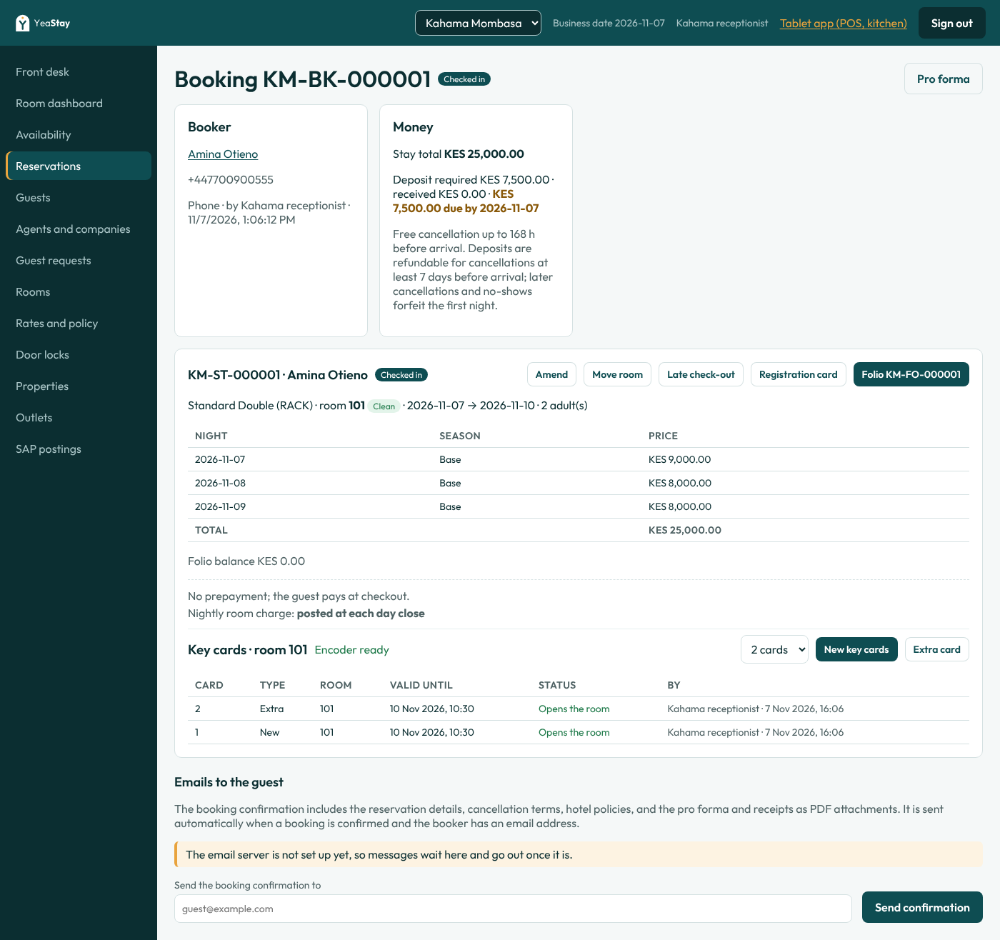
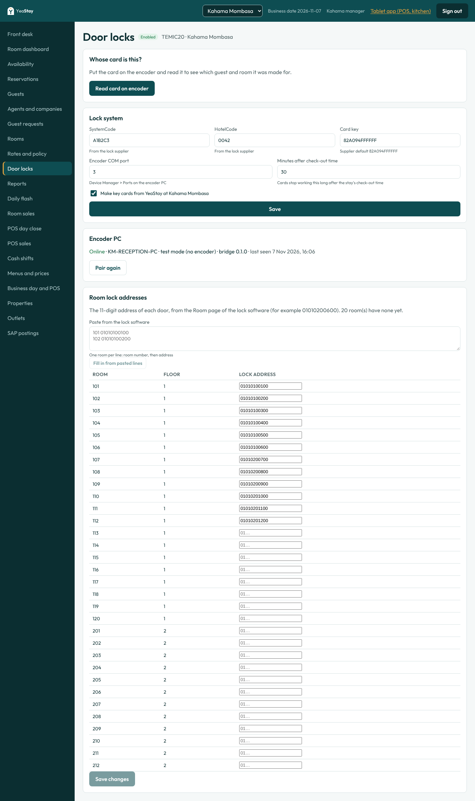

# Door locks: TEMIC20 key cards (INT-09)

All three properties use **TEMIC20 "V20 RF"** locks, with one card encoder at each reception, and **YeaStay is the only system that issues guest cards** (confirmed by Manish, 7 Nov 2026). Staff, master and other special cards are still made in the supplier's lock software.



## How it works

```
Reception browser ──► YeaStay API (cloud) ◄── outbound HTTPS ── YeaStay lock bridge (encoder PC) ──► HUNERF.dll ──► encoder (COM port)
```

- The supplier's `HUNERF.dll` is a 32-bit Windows DLL that drives the encoder over a COM port, so the cloud cannot call it. A small program, the **YeaStay lock bridge** (`apps/door-lock-bridge`, C# .NET 8, x86), runs on the reception PC the encoder is plugged into. Like the SAP worker, it only makes **outbound** HTTPS calls: it asks YeaStay for the next card about every 1.5 seconds, writes it and reports the result. Nothing has to be opened on the hotel network.
- YeaStay works out every value the DLL needs (room password, dates in the DLL's `yy-mm-dd` format, lock address and the fixed vendor values) in `packages/shared/src/doorlocks.ts`, which has its own tests. The bridge passes them through unchanged.
- Each paired bridge has its own token, which works for one property only. Only a SHA-256 of the token is stored. Pairing again replaces the old token at once.

### Cards

| Button | What it writes | Effect at the door |
|---|---|---|
| **New key card(s)** | A card with a **new room password** (`TerminateOld = 1`), plus extra copies if you ask for 2 to 4 | The first time it is used, earlier guests' cards for that room stop working |
| **Extra card** | A copy with the same room password (`TerminateOld = 0`) | Cards already given out keep working |

- **Next card number** (Door locks page) starts YeaStay's card numbers above those the supplier's software already used (K1 had reached about 3,358 by 7 Nov 2026). It can only go up.
- Cards are valid from 5 minutes before they are made until the stay's check-out time on the departure date, plus a grace period (30 minutes by default, set per property). A late check-out (FD-06) moves the end time.
- The room password comes from the supplier's `CompactCipherTime` formula, which counts in 4-minute steps. YeaStay never repeats or lowers a room's password, so two new cards made within 4 minutes still cancel each other.
- If a new card fails, the copies queued with it are cancelled and the encoder's error number is shown.
- A job that the encoder PC does not pick up within 2 minutes fails with a message to check the bridge. A job the bridge started but never answered fails after 60 seconds, and reception is asked to read the card before trying again.
- **Room move (FD-05):** the keys history stays on the stay. Cards for the old room are marked "Previous room", and reception makes a new card for the new room.
- **Read a card:** on the Door locks page, reception can put a card on the encoder to see which stay and room it was made for.

**Limits of offline locks:** nothing can cancel a card remotely. After an early checkout or a room move, the old card keeps opening that room until it expires or the next guest's new card is used at that door. The stay screen says so, and reception should collect cards where possible.

## Setting up a property



1. **Supplier codes.** Send the supplier the lock software's database file `HData.mdb` (default `D:\HUNELOCK\Data\`). They give back the **SystemCode** and **HotelCode** for that property.
2. **Door locks page** (managers): enter both codes, the encoder's **COM port** (Device Manager > Ports (COM & LPT) on the encoder PC) and the grace minutes.
3. **Room lock addresses:** each door's 11-digit address from the Room page of the lock software: `01` + building (2) + floor (2) + room (3) + door (2), for example `01010200600`. Type them in, or paste lines of `room address`.
4. Tick **Make key cards from YeaStay** and save.
5. **Pair encoder PC.** The token is shown once, as the contents of `appsettings.json` for the bridge.

## Installing the bridge on the encoder PC

Build it (any OS with the .NET 8 SDK):

```bash
cd apps/door-lock-bridge
dotnet publish src -c Release -r win-x86 -p:PublishSingleFile=true -p:SelfContained=true -o publish/win-x86
```

On the reception PC:

1. Make a folder, for example `C:\YeaStay\LockBridge`, and copy in `YeaStayLockBridge.exe`.
2. Copy in **`hunerf.dll` and every file from the supplier's `List` folder** (`borlndmm.dll`, `cc3250mt.dll`, `rtl60.bpl`, `vcl60.bpl` and the rest). They must sit next to the exe. Use the DLL build the supplier confirms as current (their pack has two).
3. Save the `appsettings.json` from the pairing step in the same folder (`appsettings.example.json` shows every setting). `Mode` is `dll` for the real encoder and `mock` for testing without one. `ComPortOverride` (0 = use the port set in YeaStay) is only for a PC where the port differs.
4. Run `YeaStayLockBridge.exe`. It logs to the console and to `logs\bridge-YYYYMMDD.txt`. To start it with Windows, add a Task Scheduler task "At log on" for the reception user that runs the exe with "Start in" set to the folder. A logged-on session is safer than a Windows service, because the supplier's DLL may show dialogs.
5. The Door locks page shows the PC as **Online** within a few seconds.

Settings can also come from environment variables: `YEASTAY_CLOUD_API_URL`, `YEASTAY_BRIDGE_TOKEN`, `YEASTAY_MODE`, `YEASTAY_BRIDGE_ID`, `YEASTAY_COM_PORT`. In mock mode, `MOCK_FAIL_CODE` makes every card fail with that error number, and `MOCK_READ_CARD_NO` is the number a read returns.

## Trying it without hardware

With the API running locally (see the README), as `km.manager`: set codes, room addresses and pair on the Door locks page. Then:

```bash
cd apps/door-lock-bridge
YEASTAY_CLOUD_API_URL=http://localhost:3000/api YEASTAY_BRIDGE_TOKEN=<token> YEASTAY_MODE=mock dotnet run --project src
```

Check a guest in as `km.reception`, open the booking and press **New key card**. The bridge logs the card it would write and the stay shows it as "Opens the room".

## Tests

- `packages/shared/src/doorlocks.test.ts`: room password formula, Nairobi dates, lock addresses, KeyCard arguments.
- `apps/api/test/doorlocks.e2e-spec.ts`: set-up permissions, pairing and token scope, new card plus copies in order, idempotent retry, newer passwords, failure cancels copies, cancel, room move history, read card, property isolation, re-pairing.
- `apps/door-lock-bridge/tests`: the poll loop, COM port override, error reporting, resending an unsent result without writing the card twice, JSON shapes, settings checks (`dotnet test apps/door-lock-bridge/tests`).

## Still open with the supplier

- Documentation for the exported but undocumented functions (`CheckoutCard`, `ClearCard`, `StopCard`, `BlacklistCard`), so returned cards can be erased at checkout.
- The list of `KeyCard` and `ReadMessage` error numbers, so YeaStay can show a plain reason.
- Which `hunerf.dll` build is current (the pack has 109,568-byte and 117,760-byte versions).
- First test on a real lock: `PassMode` is 1 as the interface note says, though one of the supplier's demos switches it to 2.
- Cards that open several rooms (`LEVEL_Pass` 13, up to 7 rooms) are not offered yet.
