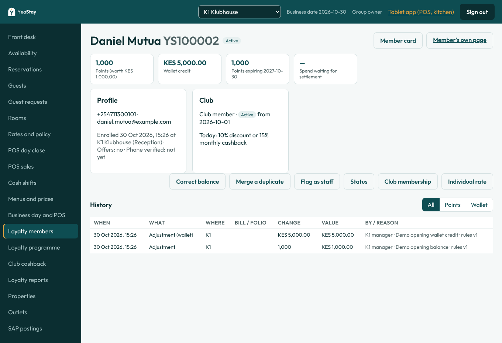
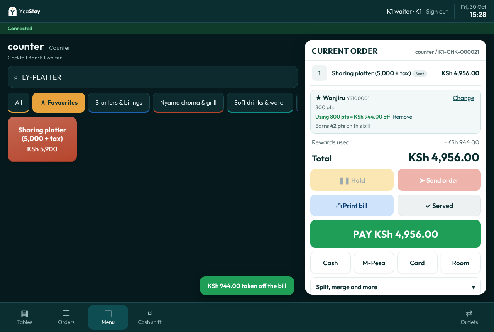

# How to test: YeaStay Rewards (loyalty and club membership)

This checklist covers the core loyalty programme and club membership from the Loyalty Development Addendum v1.2: LOY01, LOY05, LOY11 to LOY28 and CLUB01 to CLUB07. It follows the addendum's acceptance tests LAT01 to LAT16 and CAT01 to CAT12. The advanced options LOY02 to LOY10 come in a later release. The addendum replaces ADV-02 from the brief.

Most acceptance tests also run automatically in `apps/api/test/loyalty.e2e-spec.ts` (19 tests). The table at the end shows which test covers which LAT or CAT. `npm test` must be green before anyone tests by hand.

At the end there is a **10-minute customer demo script**.

## Before you start

1. Migrate and seed a database. Then run the demo data against a running API: `API_URL=… SEED_PASSWORD=… node dist/seed-demo.js` (see [demo-data.md](demo-data.md)). It creates the members below. It is safe to run again. On a server that already has the hotel and POS demo data, `DEMO_ONLY=loyalty` adds only the members.
2. Open two windows:
   - **Tablet (PWA):** `/pwa/` on the dev or test domain, or `http://localhost:5174/pwa/` locally.
   - **Back office:** the site root, or `http://localhost:5173` locally.
3. Every seeded user has the stack's `SEED_PASSWORD`.

| User | Use it for |
|---|---|
| `k1.waiter`, `sw.waiter`, `km.waiter` | The tablet: attach members, enrol, use points and credit. Waiters cannot refund. |
| `k1.cashier` | Payments and returns (a manager signs off) |
| `k1.manager`, `sw.manager`, `km.manager` | Approvals, balance corrections, merges, staff flags, club membership |
| `k1.reception` | Enrol from a guest profile and look members up |
| `group.accounts` | Month-end cashback: prepare, post. Loyalty reports. |
| `owner` | Programme settings, club rates and the second approval on a cashback batch |

### Demo members

Search on the tablet by **phone number**. Member numbers (YS…) are given in the order the demo creates them, so they can differ between servers.

| Property | Member | Phone | Starts with |
|---|---|---|---|
| K1 Klubhouse | Wanjiru Kamau (regular) | +254 712 000 101 | 800 points |
| K1 Klubhouse | Daniel Mutua (club) | +254 711 300 101 | Club tier, 1,000 points, KES 5,000 wallet credit |
| K1 Klubhouse | Acme Logistics Ltd (corporate) | +254 711 300 102 | 0 |
| K1 Klubhouse | Kevin Ochieng (staff, linked to `k1.waiter`) | +254 711 300 103 | 200 points |
| Small World | Brian Otieno (regular) | +254 722 000 202 | 800 points |
| Small World | Grace Njeri (club) | +254 755 000 505 | Club, 1,000 points, KES 5,000 wallet |
| Small World | Lukenya Engineering Ltd (corporate) | +254 711 300 202 | 0 |
| Small World | Mercy Wambui (staff, `sw.waiter`) | +254 711 300 203 | 200 points |
| Kahama Mombasa | Amina Hassan (regular) | +254 733 000 303 | 800 points |
| Kahama Mombasa | Fatuma Ali (club) | +254 711 300 301 | Club, 1,000 points, KES 5,000 wallet |
| Kahama Mombasa | Pwani Shipping Ltd (corporate) | +254 711 300 302 | 0 |
| Kahama Mombasa | Said Omar (staff, `km.waiter`) | +254 711 300 303 | 200 points |

The balances are one group-wide balance per member, so any member can be used at any property.

### Test dishes, and why the till shows tax

The addendum's examples ignore tax ("amounts exclude tax and service charges"). The till prices include VAT 16% and catering levy 2%, so every till amount is the addendum amount × 1.18. The seed adds four test dishes (category *Nyama choma & grill*, sold at every bar and restaurant) whose net price is a round number:

| Code | Name on the tablet | Till price | Eligible (net) |
|---|---|---|---|
| LY-PLATTER | Sharing platter (5,000 + tax) | 5,900 | 5,000 |
| LY-GRILL | Mixed grill for two (3,000 + tax) | 3,540 | 3,000 |
| LY-CAKE | Celebration cake (2,000 + tax) | 2,360 | 2,000 |
| LY-FEAST | Banquet feast (10,000 + tax) | 11,800 | 10,000 |

Points and cashback use the **net** amount (the programme setting *Earn on: net*). A reward is a discount on the bill before tax, so 800 points take **KES 944** off the till total (800 + 144 tax), and the till shows **4,956 due** where the addendum says 4,200. Search the tablet for `LY-` to find the dishes.

### Programme rules in force (the addendum's proposed defaults)

1 point per KES 100 eligible; 1 point = KES 1; points cover at most 20% of the eligible bill; minimum redemption 100 points; points expire after 12 months; club discount 10% or cashback 15%; stacking off, so a club member gets the discount **or** the cashback on each bill (discount by default); 25% combined ceiling when stacking is on; wallet credit covers up to 100% of the bill and expires after 12 months; drinks containing alcohol cannot be paid with points or credit (LOY25). All of these are on **Loyalty programme** in the back office.

The one-time code (OTP) is shown on the tablet screen, marked "Demo", because there is no SMS gateway yet.

---

## 1. Enrol and look up members (LOY11, LOY15, LOY24)

- [ ] Back office as `k1.reception`: **Guests**, open any guest. The **Loyalty** panel says "Not a member". Click **Enrol in YeaStay Rewards**. The Enrol button stays disabled until both "18 or over" and "accepts the programme terms" are ticked. Enrol. The panel now shows the new YS number and 0 points.
- [ ] Enrol again with a phone number an existing member uses (for example +254 712 000 101). Expect a warning naming the existing member, and a tick box "this is a different person" before you can continue.
- [ ] **Loyalty members**: search `Kamau`, `0712000101` or a YS number. Open Wanjiru. Reception sees the full profile, the balances, the expiry date, the history and the **Member card** (printable, with a QR code) and the **Member's own page** link (no sign-in needed; it shows balances and the statement).

- [ ] Tablet as `k1.waiter`: open a bill, tap **☆ Add YeaStay Rewards member** and search by phone. The tablet shows only the first name, the YS number, the points and the wallet. A waiter cannot search by name.
- [ ] Tablet: **Enrol new member** from the same dialog. The member is attached to the bill straight away.

## 2. Earn points (LAT01, LOY12, LOY14)

- [ ] Tablet as `k1.waiter`, outlet **Cocktail Bar**: **Counter sale**, add **LY-PLATTER** (5,900), **Send order**. Attach Wanjiru. The rewards panel says **Earns 50 pts on this bill**.
- [ ] Pay 5,900 by card (any reference). The bill closes. **Print receipt**: the YeaStay Rewards block shows the masked member number, 50 points earned and the new balance.
- [ ] Back office, Wanjiru's history: one *Earned* line of 50 points, at K1, with the bill number. A repeated settlement does not add a second line (the automated test replays it).

## 3. Use points (LAT02, LOY13, LOY22)

Use a member who still has 800 points (Brian at Small World, Amina at Kahama, or Wanjiru on a fresh server).

- [ ] Counter sale, **LY-PLATTER**, send, attach the member. The panel offers **Use up to 800 pts** (the cap is 20% of 5,000 = 1,000).
- [ ] Tap it. Keep 800 points. **Next: verify member**. A waiter cannot skip this step (LAT15). Tap **Send code**; the demo shows the code. Enter a wrong code first: "Wrong code. 4 attempt(s) left". Then the right code.
- [ ] The bill shows **Rewards used −944.00**, **Total 4,956.00**, and the panel says **Earns 42 pts** (4,200 net after the reward).

- [ ] Pay 4,956 by card. Member history: −800 *Used*, +42 *Earned*. The closing balance is **42**.
- [ ] Instead of the code, **Scan their card instead** uses the camera to read the member card QR (on a tablet with a camera). A card for a different member is refused.
- [ ] Tap **Remove** next to "Using … pts" on an open bill: the points go back to the member at once. An abandoned hold is released automatically after 15 minutes.

## 4. Returns (LAT05, LOY20, CAT08)

Partial return, the addendum's worked example:

- [ ] Tablet as `k1.cashier`: counter sale with **LY-GRILL** and **LY-CAKE** (5,900 together, 5,000 net). Attach a member with 800 points. Use 800 points (they are split 480 / 320 across the two items). Pay 4,956 by card. The member earns 42.
- [ ] On the closed bill tap **↩ Return items**, return 1 × Celebration cake, reason "Dropped". A manager signs off (`k1.manager`).
- [ ] Expect a refund of **KES 1,982.40** (1,680 + tax) to the card, 320 points restored and 17 earned points reversed. The member's balance is **345**.

Full return:

- [ ] Same bill again, return everything. Expect all 800 points restored and all 42 reversed.

Wallet credit and card (CAT08):

- [ ] Club member Daniel (K1). Counter sale with **LY-FEAST** (11,800). Attach Daniel and switch the benefit to **15% cashback** (with stacking off, the club discount and points/credit don't combine). Use **KES 2,000** of wallet credit and no points; verify. Pay the rest (9,440) by card.
- [ ] Return everything: KES 2,000 goes back to the wallet once and KES 9,440 is refunded to the card.

## 5. Two tills at once (LAT06, CAT10)

- [ ] Open the same member's 800-point bill on two tablets (or two browser windows). Use 800 points on the first. The second now offers 0 points: the first bill holds them. Remove them on the first, and the second can use them.
- [ ] Go offline (switch off Wi-Fi): the member and redemption buttons are disabled. Orders can still be taken.

## 6. Club members (CLUB01, CLUB02, CLUB03, CAT02, CAT04)

- [ ] Tablet, a bill with **LY-PLATTER** and Grace (Small World) or Fatuma (Kahama) attached. By default the bill shows **Club discount −590.00** and the panel says "Club discount on this bill instead of cashback".
- [ ] Tap **15% cashback**. The discount goes and the panel says **Earns KSh 750.00 cashback (credited at month end)**.
- [ ] Back office as `k1.manager`, Daniel's page: **Club membership** changes the tier, status and dates. **Individual rate** sets a personal rate, for example discount 12%, for a date range. It needs an area manager or the owner to sign off. Bills in that range use 12%; after it ends the tier rate applies again (CAT04).
- [ ] As `owner`, **Loyalty programme → Club tiers → Change rate**, effective from a future date. Bills before that date keep the old rate, and their returns use the old rate too (CAT03).

## 7. Month-end cashback (CLUB04 to CLUB07, CAT01, CAT05, CAT07, CAT12)

- [ ] Ring up club bills on cashback (see section 6) and pay them. Five **LY-FEAST** bills are KES 50,000 net, which gives **KES 7,500 at 15%** (CAT01).
- [ ] Back office as `group.accounts`: **Club cashback**, current month. The preview lists each member's spend, returns, the rate on each sale date, the entitlement and anything already credited. A month that has not ended is marked; later sales then go into an adjustment batch.
- [ ] **Save as draft regular batch**. Open it. Approving needs a **second person**: `group.accounts` prepared it, so the screen asks for another approver; sign in as `owner`.
- [ ] **Post to wallets**. Each member's wallet goes up once. Posting again does nothing more (CAT05). Each property gets one SAP journal (cashback expense / wallet liability). If the accounts are not mapped yet, **SAP accounts** on the same page shows the journals waiting: enter the two G/L codes (any test codes on dev, for example 61200 and 22150) and save, and they appear in **SAP postings**.
- [ ] Return a cashback sale after posting. The next preview shows a negative line and an **adjustment** batch takes it back, which can leave the wallet negative (CAT07).

## 8. Room charges and company bills (LAT03, LAT04, LAT08)

- [ ] Attach a member to a bill and **Room** charge it to an in-house guest. Nothing is earned yet: the member page shows "spend waiting for settlement".
- [ ] Check the guest out at reception and settle the folio. The points arrive then, once.
- [ ] Charge the bill to a company account instead: it waits until finance marks the company bill paid (member page, *Waiting for settlement* in reports).
- [ ] Split a bill with a member attached: both bills keep the member, and the earnings add up to the same total.

## 9. Corrections, merges and staff (LAT10, LAT15, LOY24, LOY27)

- [ ] Back office as `k1.reception`: the correction buttons are not there. As `k1.manager`, **Correct balance** +100 points with a reason. The history shows the manager and the reason.
- [ ] **Merge a duplicate**: move one member into another. The totals are kept, the old number stops working, and the history of both shows the move.
- [ ] Tablet as `k1.waiter`: attach **Kevin Ochieng (staff)**, who is linked to `k1.waiter`. The panel says "Staff member on their own bill: no earning". Back office, **Loyalty reports → Exceptions** lists the bill.
- [ ] As `owner`, lower *Alert: bills per member per day* to 3 in **Loyalty programme** and attach one member to 3 bills. The member appears under "3+ bills in a day" in Exceptions. Set it back to 10.

## 10. Cross-property (LAT14)

- [ ] Earn at K1 (section 2), then redeem the same member's points at Kahama as `km.waiter`.
- [ ] **Loyalty reports → Outstanding liability / Activity by outlet**: the earning shows under K1 and the redemption under Kahama.
- [ ] As `km.manager`, open the member: the history shows the K1 lines without the K1 bill details.

## 11. Rules, expiry and reports (LAT09, LAT11, LAT12, LOY19, LOY21, CAT11, CAT12)

- [ ] **Loyalty programme**: change a value, give a reason and **Save as new version**, now or from a later date. Old bills and their returns keep the version they were made under. A manager can read the rules but not change them, and a cashier cannot open the page at all (CAT11).
- [ ] **Loyalty reports → Movement and reconciliation**: opening + movements = closing, and *Ledger vs balances* is 0 for points and wallet. Expired points show in the *Expired* column. Expiry runs automatically every few minutes.
- [ ] Liability by property and by expiry month, negative balances, cashback accrued but not yet posted, activity by outlet, bills waiting for settlement and the exception lists are all on the same page.

## 12. Fiscal receipt (LAT13): partly covered

- [ ] The receipt shows the reward as its own line ("Rewards used"), and a return creates a separate return document (K1-RT-…) and a SAP credit note. The bill itself is never edited.
- KRA TIMS is not connected yet (INT-02), so no fiscal invoice or credit note is sent to KRA. LAT13 can be signed off only when the TIMS integration is built.

---

## Acceptance tests and where they run

| Test | By hand | Automated (`loyalty.e2e-spec.ts`) |
|---|---|---|
| LAT01 Standard earning | §2 | LAT01 |
| LAT02 Redemption | §3 | LAT02 |
| LAT03 Hotel settlement | §8 | room-charged spend… |
| LAT04 Splits and packages | §8 (splits). Packages (S10) not built. | |
| LAT05 Returns | §4 | LAT05 partial, LAT05 full |
| LAT06 Concurrent redemption | §5 | LAT06 |
| LAT07 Failure and recovery | §3 (hold release), §5 (offline) | holds and replays inside LAT02 and LAT01 |
| LAT08 Credit settlement | §8 | room-charged spend… company bill |
| LAT09 Rules and expiry | §11 | CAT11 (versions) |
| LAT10 Permissions and merge | §9 | LAT10, negative balance (S17) |
| LAT11 Reconciliation | §11 | ledger movement reconciles |
| LAT12 Restore and boundaries | §10, plus a DB restore on the server | LAT14 (redacted history) |
| LAT13 Fiscal invoice | §12, partly | waits for TIMS |
| LAT14 Cross-property | §10 | LAT14 |
| LAT15 Staff misuse | §3, §9 | LAT15 |
| LAT16 Benefit ceiling | below | LAT16 |
| CAT01 Monthly percentage | §7 | CAT01/CAT05 |
| CAT02 Combined benefits | §6 | CLUB02, CAT02 |
| CAT03 Effective rate changes | §6 | rates by sale date in CAT01/CAT05 |
| CAT04 Member override | §6 | |
| CAT05 Monthly rerun | §7 | CAT01/CAT05 |
| CAT06 Late settlement | §8 (room charge settled next month) | room-charged spend… |
| CAT07 Cashback refund | §7 | CAT07 |
| CAT08 Wallet tender refund | §4 | CAT08 |
| CAT09 Threshold and cap | below | |
| CAT10 Concurrency and outage | §5 | LAT06 |
| CAT11 Permissions and expiry | §9, §11 | CAT11 |
| CAT12 Reconciliation | §7, §11 | ledger movement reconciles |

**LAT16 (benefit ceiling) by hand:** as `owner`, tick *Allow benefits to combine* in **Loyalty programme** and save a version. Bill **LY-FEAST** (10,000 net) for Daniel. The 10% club discount takes 1,000 net (1,180 on the till). The redeem dialog shows "Benefits ceiling: KSh 1,770.00 left", which is 1,500 net. Asking for 900 points plus 1,000 of credit is refused with the amount left; 500 points plus 1,000 of credit is accepted. Discount, points and credit together stop at 2,500 net (25%). Untick the setting afterwards.

**CAT09 (threshold and cap) by hand:** set *Minimum monthly spend* 20,000 and *Monthly cashback cap* 3,000 in a new version. A member with 15,000 of cashback sales gets nothing in the preview; one with 50,000 at 10% gets 3,000. Set both back afterwards.

## Not in this release

- LOY02 to LOY10 (tiers, campaigns, birthday, referrals and the other advanced options).
- KRA TIMS (LAT13), SMS delivery of the code (shown on screen for now), packages and included breakfast (S10).
- The SAP G/L accounts for cashback expense and wallet liability are mapped by finance on **Club cashback → SAP accounts**. Until then, wallet and cashback journals wait in the app; saving the accounts sends each waiting journal to SAP once.

---

# 10-minute customer demo

Use the **test** domain. Have the tablet (as `k1.waiter`) and the back office (as `owner`) open side by side. Rehearse once: points used in the demo stay used, so pick a member who still has 800 points (Wanjiru, Brian or Amina) and a club member with wallet credit (Daniel, Grace or Fatuma).

**0:00 · The idea (1 min).** "One YeaStay Rewards balance across Klubhouse, Small World and Kahama. Guests earn 1 point per KES 100 on food, rooms and drinks, and 1 point is worth KES 1. Club members get 10% off or 15% back as wallet credit at month end."

**1:00 · Enrol at reception (1 min).** Back office, **Guests**, open a guest, **Enrol in YeaStay Rewards**. Point out the age and consent ticks. Show the **Member card** with its QR code and the **Member's own page**.

**2:00 · Earn and use points at the bar (3 min).** Tablet, Cocktail Bar, **Counter sale**, search `LY-PLATTER`, **Send order**. **Add member** by phone (Wanjiru, 0712 000 101). The panel shows 800 points and "Earns 50 pts". Tap **Use up to 800 pts**, **Send code**, type the code (on screen for the demo; SMS later). The bill drops by 944 (800 plus tax) and now earns 42 points. Pay by card and print the receipt with the rewards block.

**5:00 · Club member (2 min).** New bill, LY-PLATTER, add Daniel (0711 300 101). The 10% club discount is applied. Switch to **15% cashback**: the bill goes back to full price and shows KES 750 cashback for month end. Use KES 2,000 of his wallet credit, verify and pay.

**7:00 · Month end (1.5 min).** Back office, **Club cashback**: the preview lists every club member with spend, rate and amount. Save a draft. Approval needs a second person (sign in as group accounts or the owner). Post to wallets, and each property gets its SAP journal.

**8:30 · Control and reports (1.5 min).** **Loyalty reports**: movement reconciles to zero difference, the outstanding liability is by property, and the exceptions show staff on their own bills and members on many bills a night. **Loyalty programme**: every rule is configurable and each change is a dated version, so old bills never change.

**10:00 · Questions.** Name what comes next: SMS codes, TIMS fiscal invoices with the reward line, and the advanced options (LOY02 to LOY10).
